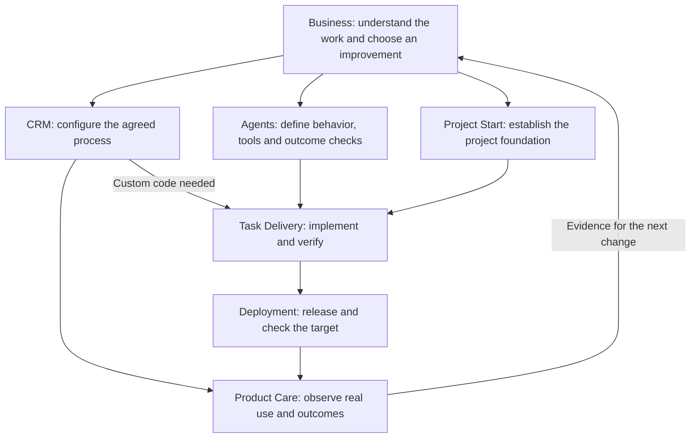

# Codex Agent Graphs

**Reusable AI workflows for building software, improving business processes, implementing CRM and delivering agents.**

[English](README.md) · [Русский](README.ru.md) · [Installation](docs/INSTALLATION.md) · [Documentation](docs/README.md) · [Changelog](docs/CHANGELOG.md)

[](products/business-automation/README.md)
[](products/crm-business-pack/README.md)
[](products/agent-lifecycle/README.md)
[](docs/INSTALLATION.md)
[](https://github.com/ArtemArzi/codex-agent-graphs/commits/main/)

Bring a real task, choose the matching entrypoint, and let the agent work from
context through implementation and verification. The same repository connects
business goals, software delivery, CRM configuration and the agent lifecycle.
Start at the stage you need and preserve decisions already made in the project.

Built for **Codex CLI and Codex Desktop**, with a separate **Claude Code plugin**
distribution. An independent community project.

## Choose your starting point

| Your task | Start with | What you get |
| --- | --- | --- |
| Prepare a new or inherited codebase | [`$project-start`](skills/project-start/SKILL.md) | Project context, architecture, engineering guidance and a usable plan |
| Build, fix or release software | [`$task-delivery`](skills/task-delivery/SKILL.md) | A scoped change, appropriate tests, review and handoff; [`$deployment`](skills/deployment/SKILL.md) owns release |
| Understand and improve a business process | [`$business-work`](products/business-automation/README.md) | Current work, a chosen improvement, a future process and checks for adoption |
| Configure Bitrix24 or amoCRM | [`$crm-implementation`](products/crm-business-pack/README.md) | A process translated into CRM configuration, integrations and launch checks |
| Design, verify or hand over an AI agent | [`$agent-project-design`](products/agent-lifecycle/README.md) | Agent behavior, tools, memory where needed, outcome E2E and pilot/handover |
| Investigate a question | [`$research`](skills/research/SKILL.md) | A sourced answer with evidence and uncertainty |
| Maintain a running product | [`$product-care`](skills/product-care/SKILL.md) | An observed problem, a useful next action or a reason to leave things as they are |

## One repository, complementary packs

| Area | Contents | Installation |
| --- | --- | --- |
| **Engineering workflows** | Project Start, Research, Task Delivery, Software Factory, Deployment, Product Care and supporting skills | Default installer; `--skills-only` preserves host settings |
| **[Business Automation](products/business-automation/README.md)** | 11 skills: business workflow, hypothesis checks, NMT methods and recent external signals | `--skills-only --pack business-automation` |
| **[CRM Business Pack](products/crm-business-pack/README.md)** | One skill with Bitrix24/amoCRM references for design, integrations, launch and support | Published sources; not registered in the installer yet |
| **[Agent Lifecycle](products/agent-lifecycle/README.md)** | 4 skills: project design, memory lifecycle, outcome E2E and commercial delivery | `--skills-only --pack agent-lifecycle` |

Skill sources live once in `skills/`. Product folders contain manifests,
provenance and validation. Packs reuse existing capabilities when available;
installing one pack does **not** install every companion or every other pack.

## How the work connects



These are conditional routes. A CRM setting can stay inside the CRM workflow;
a small code fix can start directly in Task Delivery. **Software Factory** adds
isolated sequential or parallel work when the dependencies justify it.
**Research** supports any stage that needs evidence.

For example, a service company loses inbound enquiries. Business Work identifies
where the handoff breaks; the CRM pack designs the relevant fields and rules.
If a custom connector is needed, Task Delivery implements it and Deployment
releases it. An agent is added only if the process needs model decisions.
Product Care then checks whether people use the change and what actually improved.

## Quick start

Requirements: **Git, Python 3.11+, and Codex CLI or Codex Desktop**.

```bash
git clone https://github.com/ArtemArzi/codex-agent-graphs.git
cd codex-agent-graphs

# Preview the engineering skills update for one CLI/WSL home.
python3 scripts/install.py plan --skills-only --wsl
python3 scripts/install.py install --skills-only --wsl
python3 scripts/install.py verify --skills-only --wsl
```

This installs the engineering skills and shared runtime while preserving models,
profiles, roles, policies and credentials. On a fresh host, read the
[full setup instructions](docs/INSTALLATION.md) if you also need the supplied
agent roles and global policies.

Business and agent packs are selected separately. For example, preview the
business pack for your CLI home:

```bash
python3 scripts/install.py plan --skills-only --pack business-automation --wsl
```

Review the selected root, then use the same arguments with `install` and
`verify`. Use `--pack agent-lifecycle` for the agent pack. For both configured
WSL/Desktop environments use `--all`; shared-pack roots must be unambiguous.
[Target paths, shared roots, updates and Claude Code](docs/INSTALLATION.md).

Open a new session after installation. Then try a concrete request:

```text
$project-start Prepare this existing repository. Preserve its architecture and document material gaps.

$business-work Map how this company handles enquiries and propose one measurable improvement. Analysis only.

$agent-project-design Design a support agent for our current process, including authority boundaries and outcome checks.
```

For CRM, start by asking the agent to read
`skills/crm-implementation/SKILL.md` from your clone.
[CRM usage and installation status](products/crm-business-pack/README.md).

## What makes the workflows useful

- **Project context carries forward.** Plans, decisions and handoffs stay with the project; existing work is preserved.
- **Verification follows the task.** Appropriate tests, live checks and independent review support the relevant requirement.
- **Coordination scales with the work.** Ordinary tasks stay with the root agent; bounded helpers and durable controllers are used when justified.
- **Delivery and results stay distinguishable.** Local checks, live release, provider effects, human acceptance and business outcomes have separate evidence.

The four graph-backed workflows are Project Start, Research, Task Delivery and
Continuous Improvement. Other skills and product packs can work through native
project processes. [Workflow architecture and operating details](docs/WORKFLOWS.md).

## Versions, checks and updates

The badges read the **published pack manifests**; they update when the source
version changes, subject to badge caching. Each pack has its own version.
Graph versions describe execution contracts, rather than a single suite release.
[Changelog and version sources](docs/CHANGELOG.md).

```bash
python3 scripts/check_all.py
git diff --check
```

These checks validate repository structure, controllers, packaging and tests.
Real CRM operation, live-agent E2E, deployment and adoption need project evidence.
Publishing a commit and updating an installed copy are separate operations.

## Explore the repository

| Path | Purpose |
| --- | --- |
| [`skills/`](skills/) | Reusable instructions, references, scripts and graph contracts |
| [`products/`](products/) | Pack manifests, guides, sources and validation |
| [`agents/`](agents/) · [`policies/`](policies/) | Codex roles and managed host policies |
| [`agent-graph-runtime/`](agent-graph-runtime/) | Shared deterministic artifact lifecycle |
| [`scripts/`](scripts/) · [`tests/`](tests/) | Installation, packaging and verification |
| [`docs/`](docs/README.md) | Setup, workflow guides, research and historical task evidence |

Read [AGENTS.md](AGENTS.md) before contributing. Keep changes scoped, preserve
local work, and include reproducible evidence with an issue or pull request.

There is no repository-wide `LICENSE` file. Component notices are recorded in
[Business third-party sources](products/business-automation/THIRD_PARTY.md) and
[Agent third-party sources](products/agent-lifecycle/THIRD_PARTY.md); the Claude
plugin metadata has its own license label. Check the relevant source notices
rather than treating the entire collection as uniformly licensed.
