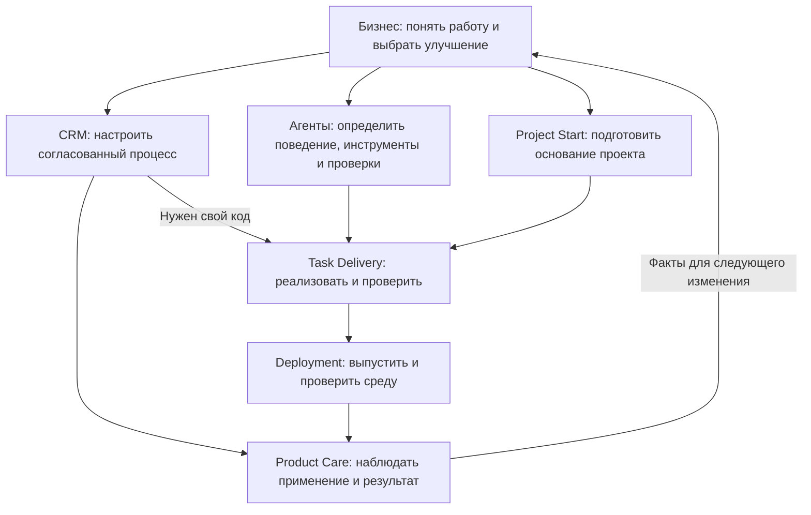

# Codex Agent Graphs

**Рабочие процессы для ИИ: разработка продуктов, улучшение бизнеса, внедрение CRM и создание агентов.**

[English](README.md) · [Русский](README.ru.md) · [Установка](docs/INSTALLATION.md) · [Документация](docs/README.md) · [Изменения и версии](docs/CHANGELOG.md)

[](products/business-automation/README.md)
[](products/crm-business-pack/README.md)
[](products/agent-lifecycle/README.md)
[](docs/INSTALLATION.md)
[](https://github.com/ArtemArzi/codex-agent-graphs/commits/main/)

Дайте агенту реальную задачу и выберите подходящий вход. Репозиторий связывает
бизнес-цель, разработку, настройки CRM и жизненный цикл агента: от контекста
и решения до реализации, проверки и наблюдения результата. Можно начать
с нужного этапа, сохранив уже принятые решения проекта.

Основные среды: **Codex CLI и Codex Desktop**. Для **Claude Code** есть native установщик и отдельная
поставка через плагин. Независимый проект сообщества.

## С чего начать

| Ваша задача | Вход | Результат |
| --- | --- | --- |
| Вести маркетинг компании на российском рынке | [`$marketing-work`](products/marketing-cycle/README.md) | Исследование, стратегия, кампания, обработка, исполнение, повтор и решение по результатам |
| Подготовить новый или старый проект | [`$project-start`](skills/project-start/SKILL.md) | Контекст, архитектура, инженерные правила и рабочий план |
| Написать, исправить или выпустить код | [`$task-delivery`](skills/task-delivery/SKILL.md) | Изменение, применимые тесты, ревью и передача результата; выпуском владеет [`$deployment`](skills/deployment/SKILL.md) |
| Разобраться в работе бизнеса и улучшить процесс | [`$business-work`](products/business-automation/README.md) | Текущая работа, выбранное улучшение, будущий процесс и проверка внедрения |
| Найти бизнес-возможность или превратить процесс в продукт | [`$business-work`](products/business-model/README.md) | Бизнес-модель, экономика, проверяемые предположения и решение о следующем шаге |
| Настроить Bitrix24 или amoCRM | [`$crm-implementation`](products/crm-business-pack/README.md) | Процесс, переведённый в модель CRM, настройки, интеграции и проверку запуска |
| Создать, проверить или передать ИИ-агента | [`$agent-project-design`](products/agent-lifecycle/README.md) | Поведение, инструменты, нужная память, сквозные проверки, пилот и передача |
| Исследовать вопрос | [`$research`](skills/research/SKILL.md) | Вывод с источниками, доказательствами и обозначенной неопределённостью |
| Продумать неясный продукт или задачу | [`$grill-me`](skills/grill-me/SKILL.md) | Зависимые раунды вопросов; [`$grill-with-docs`](skills/grill-with-docs/SKILL.md) также фиксирует согласованные термины и решения |
| Найти полезные архитектурные улучшения | [`$improve-codebase-architecture`](skills/improve-codebase-architecture/SKILL.md) | Кандидаты с доказательствами и компромиссами до реализации выбранной правки |
| Создать или проверить публичный сайт | [`$website-standards`](skills/website-standards/SKILL.md) | Техническое качество, SEO, аналитика и надёжный приём заявок через существующих владельцев |
| Поддерживать работающий продукт | [`$product-care`](skills/product-care/SKILL.md) | Разбор наблюдаемой проблемы, полезное действие или основание ничего не менять |

## Один репозиторий, дополняющие друг друга паки

| Область | Что внутри | Установка |
| --- | --- | --- |
| **[Маркетинг полного цикла](products/marketing-cycle/README.md)** | 5 навыков: ведение, стратегия, кампания, измерение и клиентский цикл; Россия и существующие владельцы компании | `--skills-only --pack marketing-cycle` |
| **Инженерные процессы** | Project Start, Research, Task Delivery, Software Factory, Deployment, Product Care и вспомогательные скиллы | Общий установщик; `--skills-only` сохраняет настройки среды |
| **[Бизнес и автоматизация](products/business-automation/README.md)** | 11 скиллов: бизнес-процесс, проверка гипотез, методы NMT и свежие внешние сигналы | `--skills-only --pack business-automation` |
| **[Бизнес-модель](products/business-model/README.md)** | Общий business-work и 3 новых скилла: модель, экономика, процесс → продукт; российский рынок по умолчанию | `--skills-only --pack business-model` |
| **[CRM](products/crm-business-pack/README.md)** | Один скилл со справочниками Bitrix24/amoCRM: проектирование, обмен, запуск и сопровождение | Исходники опубликованы; в установщике пока не зарегистрирован |
| **[Жизненный цикл агентов](products/agent-lifecycle/README.md)** | 4 скилла: проектирование, память, сквозная проверка результата и коммерческая передача | `--skills-only --pack agent-lifecycle` |

Исходник каждого скилла хранится один раз в `skills/`. В `products/` лежат
состав, происхождение и проверки паков. Доступные возможности переиспользуются
по задаче; установка одного пака **не устанавливает все остальные паки**
и все упомянутые дополнения.

## Как всё связано



Это маршруты по необходимости. Настройка CRM может остаться внутри CRM-процесса,
а небольшое исправление кода начинается сразу в Task Delivery. **Software Factory**
добавляет изолированную последовательную или параллельную работу, когда это
оправдано зависимостями. **Research** помогает на любом этапе, где нужны источники.

Например, сервисная компания теряет входящие заявки. Business Work выясняет,
где нарушается передача; CRM-пак описывает нужные поля и правила. Если нужен
свой коннектор, Task Delivery реализует его, а Deployment выпускает.
Агент добавляется, если процессу нужны решения модели. Product Care проверяет,
применяют ли люди изменение и что действительно улучшилось.

## Быстрый старт

Нужны **Git, Python 3.11+ и Codex CLI или Codex Desktop**.

```bash
git clone https://github.com/ArtemArzi/codex-agent-graphs.git
cd codex-agent-graphs

# Посмотреть обновление инженерных скиллов для одного CLI/WSL-профиля.
python3 scripts/install.py plan --skills-only --wsl
python3 scripts/install.py install --skills-only --wsl
python3 scripts/install.py verify --skills-only --wsl
```

Этот режим устанавливает инженерные скиллы и общий runtime, сохраняя модели,
профили, роли, политики и credentials. На новом хосте прочитайте
[инструкцию полной настройки](docs/INSTALLATION.md), если нужны также
поставляемые роли агентов и глобальные правила.

Бизнес-пак и агентский пак выбираются отдельно. Например, посмотреть план
установки бизнес-пака для CLI:

```bash
python3 scripts/install.py plan --skills-only --pack business-automation --wsl
```

После проверки целевого каталога выполните те же аргументы с `install` и
`verify`. Для агентского пака укажите `--pack agent-lifecycle`. Для обеих
настроенных сред WSL/Desktop используйте `--all`; общий каталог пака должен
определяться однозначно.
[Пути, общие каталоги, обновление и Claude Code](docs/INSTALLATION.md).

После установки откройте новый сеанс и попробуйте конкретную задачу:

```text
$project-start Подготовь существующий репозиторий. Сохрани архитектуру и опиши существенные пробелы.

$business-work Разбери, как компания обрабатывает обращения, и предложи одно измеримое улучшение. Пока только анализ.

$agent-project-design Спроектируй агента поддержки для текущего процесса: границы действий и проверка результата.
```

Для CRM сначала попросите агента прочитать
`skills/crm-implementation/SKILL.md` из вашего клона.
[Применение и статус установки CRM](products/crm-business-pack/README.md).

## Почему процессы полезны

- **Контекст остаётся с проектом.** Планы, решения и передача результата сохраняются вместе с существующей работой.
- **Проверки следуют задаче.** Тесты, наблюдения в реальной среде и независимое ревью подтверждают нужное требование.
- **Координация растёт по необходимости.** Обычную задачу ведёт основной агент; помощники и контроллеры подключаются при обоснованной пользе.
- **Готовность и эффект проверяются отдельно.** Локальная проверка, выпуск, действие провайдера, приёмка людьми и результат бизнеса имеют свои доказательства.

Четыре процесса с графами: Project Start, Research, Task Delivery и Continuous
Improvement. Остальные скиллы и паки могут работать через текущие процессы проекта.
[Архитектура процессов и подробности работы](docs/WORKFLOWS.md).

## Версии, проверки и обновление

Бейджи читают версии **опубликованных манифестов паков** и обновляются после
изменения исходника с учётом кеша сервиса. У каждого пака своя версия.
Версии графов описывают контракты исполнения, а не единый релиз всего набора.
[Журнал изменений и источники версий](docs/CHANGELOG.md).

```bash
python3 scripts/check_all.py
git diff --check
```

Проверяется структура репозитория, контроллеры, упаковка и тесты. Живая CRM,
сквозная работа агента, выпуск и внедрение требуют фактов из конкретного проекта.
Публикация коммита и обновление установленной копии выполняются отдельно.

## Карта репозитория

| Путь | Назначение |
| --- | --- |
| [`skills/`](skills/) | Инструкции, справочники, скрипты и контракты графов |
| [`products/`](products/) | Состав паков, руководства, источники и проверки |
| [`agents/`](agents/) · [`policies/`](policies/) | Роли Codex и управляемые правила хоста |
| [`agent-graph-runtime/`](agent-graph-runtime/) | Общий детерминированный жизненный цикл артефактов |
| [`scripts/`](scripts/) · [`tests/`](tests/) | Установка, упаковка и проверки |
| [`docs/`](docs/README.md) | Настройка, процессы, исследования и история задач |

Перед изменениями прочитайте [AGENTS.md](AGENTS.md). Сохраняйте чужую работу,
ограничивайте область изменений и прикладывайте воспроизводимые факты к issue или PR.

Общего файла `LICENSE` в репозитории нет. Условия компонентов описаны в
[источниках бизнес-пака](products/business-automation/THIRD_PARTY.md) и
[источниках агентского пака](products/agent-lifecycle/THIRD_PARTY.md);
метаданные Claude-плагина содержат собственную отметку лицензии.
Учитывайте условия конкретных источников, а не единую лицензию всей коллекции.

## Стандарты сайтов и цикл разработки

[Website Standards](skills/website-standards/SKILL.md), [SEO](skills/seo/SKILL.md),
[Web Measurement](skills/web-measurement/SKILL.md) и
[Reliable Leads](skills/reliable-leads/SKILL.md) входят в инженерный комплект.
[Карта цикла разработки](docs/DEVELOPMENT_PIPELINE.ru.md) связывает проектирование
через использование, простоту кода, тесты и обязанности при выпуске.
