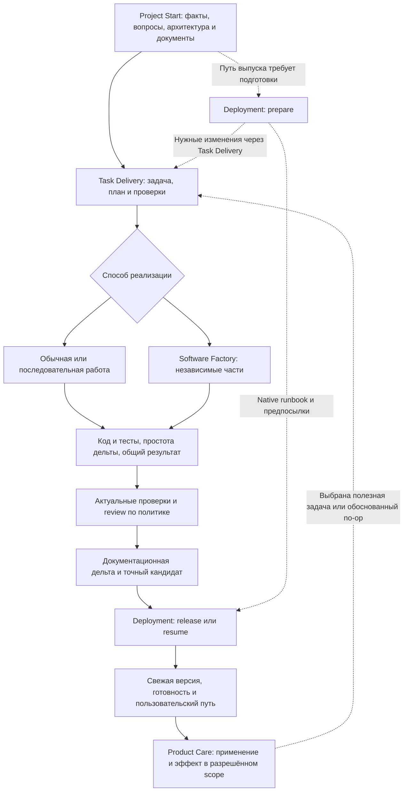

# Цикл разработки продукта

Владельцы: **Project Start → Task Delivery (при пользе — Software Factory) →
Deployment → Product Care → следующая задача**. Это карта существующих навыков,
не новый controller или обязательная цепочка отдельных агентов.

Product Care не создаёт задачу при no-op: следующий шаг может быть наблюдением
или сохранением поведения. Release выполняется только при нужных полномочиях;
прерывание/неизвестный исход сначала разбирает resume. Тривиальные изменения
получают пропорциональные проверки, а риск определяет независимую приёмку.

## Новый и существующий проект

Bootstrap определяется отсутствием рабочего основания, а не возрастом кода.
В существующем проекте сначала восстанови реальный путь и принятые решения,
отобрази хорошие документы на роли и заполни пробелы. Не перепроектируй систему
только ради внедрения навыка. При готовом основании maintenance обновляет
затронутые роли; локальная ясная задача не начинает bootstrap автоматически.

Действующие native требования сохраняются. Например, foundation manifest
требует реальное сравнение стека либо подлинное внешнее ограничение. Сохраняемый
стек позволяет переиспользовать актуальное исследование, но не выдумывать варианты,
ограничение или completed. Новый существенный выбор получает реалистичные
альтернативы, причины и статус решения.

## Что применяется в каждом месте

| Владелец | Условие и материал | Проверяемый результат |
|---|---|---|
| Project Start | Intake; доступные grilling/domain-modeling и architecture-playbook | Существенные требования/источники/неизвестное, принятые решения и следующий зависимый шаг |
| Project Start / TD | Неясный продукт или явная просьба об интервью: grill-me → grilling; grill-with-docs при документировании модели | Зависимые раунды вопросов, согласованные правила и открытые вопросы у существующего владельца; ясная правка не начинает полный разбор |
| Project Start / TD | Архитектурный обзор через improve-codebase-architecture | Кандидаты по реальной сложности изменений, сравнение пользы/рисков; выбранная реализация остаётся в TD |
| Project Start | [Проектирование через использование](../skills/project-start/references/architecture-from-usage.md) при существенной границе | Примеры вызовов, результаты/ошибки/эффекты, владелец состояния, критерий проверки |
| Project Start → TD | План сквозных срезов по размеру результата | Точные разделы решений, scope, зависимости и готовность среза |
| TD → Software Factory | Явный запрос или полезная независимая работа | Обоснованный ordinary/sequential/parallel; стабильные контракты и изоляция ресурсов |
| Task Delivery | Good-test reference доступного адаптированного Superpowers и собственные правила оракула | Независимые ожидания, существенный реальный эффект и обнаруживаемая ошибка |
| Task Delivery | TDD только по запросу или правилам проекта | Действительный RED, минимальный GREEN, затем refactor |
| Task Delivery | [Простота изменённого кода](../skills/task-delivery/references/code-simplicity.md) перед итоговыми проверками | Собственная дельта без неоправданной сложности; отсутствие полезного упрощения тоже нормальный итог |
| Task Delivery | Verification Loop и реальные проектные команды | Актуальные исходы tests/types/lint/build и честные gaps; reviewer read-only |
| Deployment | Prepare/release/resume, native runbook/journal | Точный кандидат, применимые source/artifact/environment проверки, разрешённая активация и свежий readback |
| Deployment → Product Care | Ожидаемый эффект входит в задачу | Вопрос, версия/сценарий, разрешённый источник, trigger/window и известный владелец либо unknown |

Справочник — часть пакета скилла. Указатель в основном навыке задаёт условие
чтения и ожидаемый результат. Наличие ссылки или поля «прочитано» не доказывает
применение. Документальный контракт проверяется содержательно; команды и
изолированные сценарии дают отдельные, ограниченные доказательства.

## Кто делает работу

Автор пишет по engineering standard сразу и добавляет относящиеся тесты.
Он просматривает собственную дельту до финальных проверок. Независимый reviewer
проверяет поведение, тесты и структуру по текущему порогу, не редактируя код.
Замечания исправляет автор или worker с точной областью; затронутые проверки
и review становятся актуальными после исправления. Отдельный cleanup-worker
не запускается ради названия этапа.

Factory не заменяет эту ответственность. До двух писателей получают раздельные
owned files и стабильные интерфейсы. Shared БД, порты, кеши, generated outputs
и браузерные сессии изолируются отдельно либо конфликтующая работа выполняется
последовательно. Root проверяет объединённое поведение, а Deployment получает
одного кандидата. Параллельность сама по себе не доказывает ускорение.

## Готовность этапов

Для применимого требования в существующем плане/задаче/handoff укажи результат,
фактическую проверку и статус. Неприменимость имеет причину. Отложенная проверка
имеет следующий trigger и последствие для готовности; обязательная для выпуска
остаётся препятствием к утверждению о готовности выпуска.

Во время кода выполняются затронутые проверки. Перед выпуском сохраняется
проектный обязательный набор; native verifier решает reuse результатов для
точного кандидата. Смена навыка не требует повторять unchanged suite, но новый
артефакт, конфигурация или окружение требуют соответствующих проверок.
После активации версия и нужный путь проверяются свежим наблюдением.

Технический PASS, активация версии, доставка провайдера, применение людьми
и бизнес-эффект — отдельные утверждения. Product Care не придумывает эффект
из успешного деплоя, не назначает расписание одной заметкой и не начинает
следующие внешние действия без уже имеющейся авторизации.

## Установка и границы доказательств

Новые ссылки входят в обычные trees Project Start/Task Delivery; installer
поставляет их вместе с остальными ресурсами. Используй штатный skills-only
plan/install/verify, сохраняя drift и настройки. Коммит исходников сам по себе
не обновляет установленный пакет или уже активный чат.

Статическая валидация и fixture-пилоты подтверждают проверенные сценарии.
Они не гарантируют все будущие решения агента, реальный production rollout,
исполнение Factory на другом хосте или продуктовый эффект.
