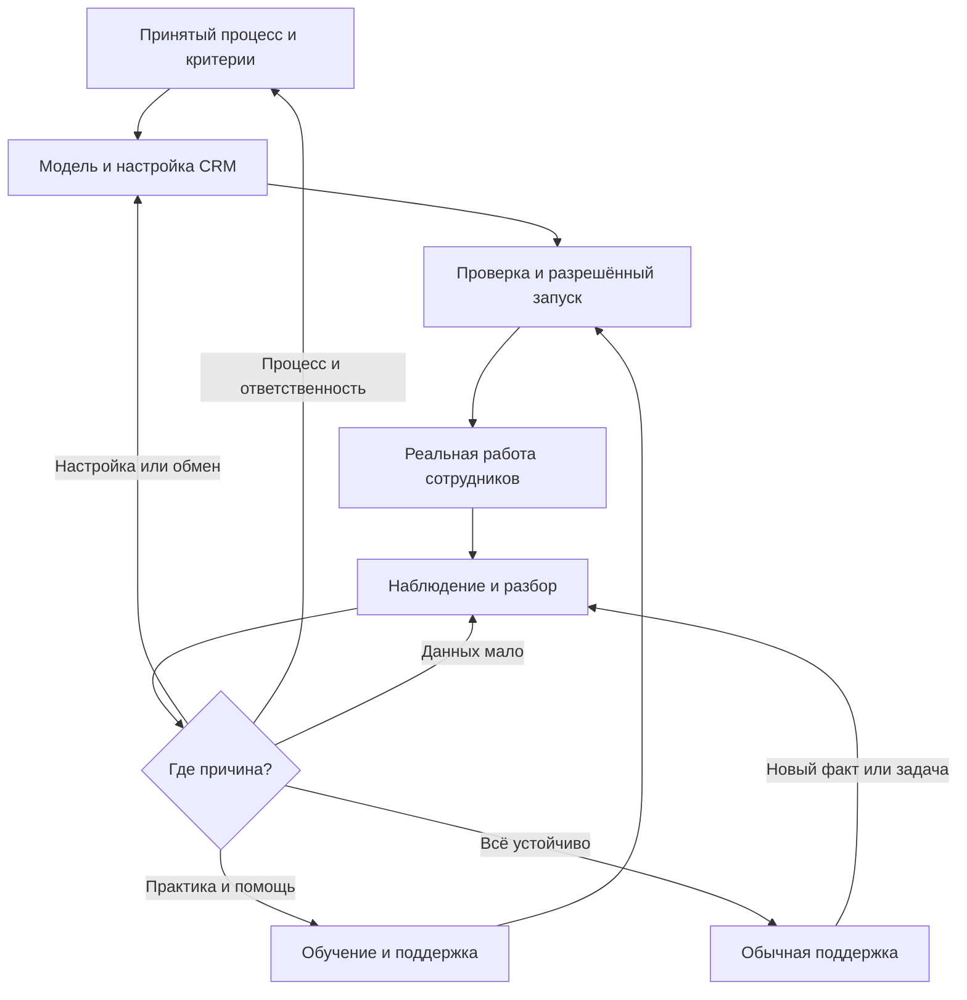

# CRM-бизнес-пак

Версия продукта: **1.0.0**. [Состав](pack.json).
Один вход: [`crm-implementation`](../../skills/crm-implementation/SKILL.md).

Пак переводит принятый процесс в настройки Bitrix24 или amoCRM, проверяет
интеграции, запуск и работу сотрудников, затем возвращает выявленную проблему
к нужному исправлению. Это инструкции для агента без своего сервера и CRM-клиента.

## Состав и источники

| Часть | Канонический источник |
| --- | --- |
| Вход, выбор действия и обратного пути | [SKILL.md](../../skills/crm-implementation/SKILL.md) |
| Схема процесса → модель и настройки CRM | [Проектирование](../../skills/crm-implementation/references/blueprint.md) |
| Обмен, сбой, восстановление и повторная проверка | [Интеграции](../../skills/crm-implementation/references/integrations.md) |
| Перенос, запуск, люди и сопровождение | [Запуск и сопровождение](../../skills/crm-implementation/references/launch-and-care.md) |
| Платформенные особенности | [Bitrix24](../../skills/crm-implementation/references/bitrix24.md) / [amoCRM](../../skills/crm-implementation/references/amocrm.md) |
| Методические основания и кандидаты | [Источники](../../skills/crm-implementation/references/sources-and-reuse.md) |

Папка продукта хранит состав и проверку, исходник скилла лежит один раз в
`skills/crm-implementation`. Читается только нужная ветка.

Бизнес-пак владеет целью, процессом и оценкой эффекта; CRM-пак — настройками,
интеграциями и свидетельствами их работы; инженерный цикл проекта — собственным
кодом и выпуском. Принятые правила и следующий шаг остаются в существующем
документе дела. Дополнительные скиллы подключаются только при доступности,
не копируются и не являются обязательными зависимостями каждого запроса.

## Замкнутый цикл

Возврат выбирается по причине. После исправления проверяется исходный случай,
затем применение. Собственный компонент передаётся разработке и принимается
обратно CRM-сценарием. Устойчивый участок остаётся на обычной поддержке;
новые изменения и автоматический мониторинг не запускаются без основания.

## Использование и установка

После клонирования можно указать агенту полный путь к
`skills/crm-implementation/SKILL.md`:

> Используй crm-implementation из этого репозитория. В существующей Bitrix24
> заявки иногда теряются между сайтом и сделкой. Разбери один случай и выбери
> исправление. Сейчас разрешены только анализ и подготовка.

Публикация исходников не устанавливает скилл в Codex CLI или Desktop.
Этот продукт пока не зарегистрирован в штатном установщике; команда
`--pack crm-business-pack` не заявляется поддерживаемой. Установка — отдельная
операция через действующие правила и проверку уже существующих скиллов,
без дублей и изменений моделей, аккаунтов или подключений.

Для настоящей настройки нужен разрешённый транспорт выбранной CRM.
Существующие Bitrix-скиллы подключаются при наличии. Технические amoCRM-кандидаты
описаны как варианты, не установлены автоматически; Kommo не считается
готовым российским amoCRM-подключением только по названию или числу инструментов.

## Проверка и обслуживание

[Результаты проверки](VALIDATION.md), [учебные запросы](validation/SCENARIOS.md)
и [фактические ответы](validation/FORWARD-RESULTS.md).
Нативная валидация, ссылки/YAML и независимый разбор восьми вымышленных запросов
проверяют инструкцию. Живая CRM, автоматический выбор новым чатом, сотрудники
и бизнес-эффект требуют отдельных наблюдений.

Обновления готовятся сначала в каноническом репозитории: изменённые инструкции,
проверка, версия продукта, разрешённая публикация и затем установка точной
версии. Внешние runtime и чужие исходники не входят в поставку; источники
и ограничения переноса указаны в руководстве. Публичность репозитория сама
по себе не меняет условия сторонних материалов.
