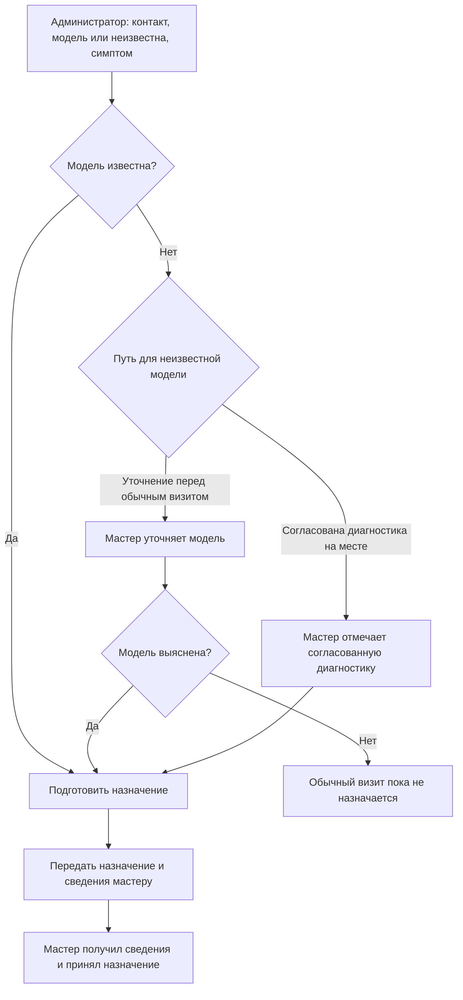

# Фактические учебные ответы

Вымышленные запросы A–H из SCENARIOS.md. Выполнены одним независимым рецензентом в одном контексте; B исправлен после проверки соответствия исходному правилу. Реальных CRM-вызовов нет.

## Случай A

Первый участок предлагаю ограничить передачей обращения от администратора мастеру до назначения визита. Наблюдаемый сбой: мастер приехал без модели и нужной детали, потребовался второй визит. Забывчивость пока версия владельца: неизвестно, спросили ли модель, куда записали и видел ли её мастер.

В существующем документе дела зафиксировать разбор последнего обращения:

| Что восстановить | Какие данные нужны |
| --- | --- |
| Начало | Время и канал обращения; кто принял |
| Вход | Контакт для обратной связи, модель или отметка «неизвестна», симптом |
| Передача | Кто записал, где, когда мастер получил сведения и что увидел |
| Подготовка | Кто уточняет неизвестную модель; кто решает о детали и визите |
| Результат | Мастер получил существенные сведения и подтвердил готовность либо явно обозначил недостающее |
| Исключение | Что делать, если модель не удаётся выяснить; правило ещё требуется принять |

Ближайший шаг: администратор и мастер вместе восстановят этот случай по тетради и доступным сообщениям; владелец решит порядок уточнения. Проверить гипотезу на следующем похожем обращении: сведения доступны мастеру до назначения, недостающее явно видно. Это предложение ограниченного пилота, ещё не принятый процесс. Пока рано обещать, что новое обязательное поле или amoCRM устранит второй визит. business-work недоступен; выполнен ограниченный разбор, без заявлений о применении его специальной методики.

---
Маршрут применения: crm-implementation/SKILL.md
Фактически прочитано перед применением: SKILL.md, validation/SCENARIOS.md и все шесть references/*.md одним пакетом. Указанный маршрут показывает использованные для этого случая разделы; раздельная экономность загрузки этим прогоном не проверена.
Статус: учебный ответ по вымышленному входу, без CRM-вызовов или внешних действий.

## Случай B

Подготовлена проектная модель для принятого участка. Она дополняет действующий документ дела; реальные объекты, поля и возможности портала предстоит сверить до настройки. Цены и оплаты не затрагиваются.

Предложение: использовать существующий объект обращения Bitrix24, если он уже есть. При отсутствии подходящего объекта рассмотреть сделку для одного обращения, связанную с контактом; отдельную сущность ремонта сейчас не вводить. Одному контакту могут соответствовать разные обращения; совпадение телефона не означает дубль.

| Элемент | Назначение и правило | Ответственный / проверка |
| --- | --- | --- |
| Контакт + связь обращения | Клиент и способ связи; привязан к конкретному обращению | Администратор; мастер видит нужный контакт |
| Модель, строка | Допускает неизвестность при приёме; нужна до обычного визита | Администратор записывает; мастер уточняет перед обычным визитом либо отмечает согласованную диагностику |
| Симптом, текст | Сведения о неисправности из принятого процесса | Администратор; сохранённый текст доступен мастеру |
| Диагностика на месте, признак | Исключение только при согласовании; факт согласования фиксируется в обращении | Мастер отмечает согласованную диагностику; порядок и лицо согласования уточнить у владельца, не выдумывать |
| Ответственный мастер / назначение | Исполнитель, сведения о визите и подтверждение принятия | Мастер; назначение не считать принятым по одному уведомлению |
| Стадии, предложение | Принято → уточнение при необходимости → готово к назначению → передано → принято мастером | Имена и существующие стадии сверить, лишние не создавать |

Редактируемая схема Mermaid:

Проверки проекта: обычное обращение с моделью доходит до принятия мастером; неизвестная модель не мешает приёму, но препятствует обычному визиту; согласованная диагностика допускает неизвестную модель и назначение без обязательного предварительного уточнения модели; несогласованная не допускает; администратор и мастер работают под своими ролями, связь и данные сохраняются. Принятие мастером фиксируется явно. Точные ID, права и механизм ограничения перехода не проверены: это проектирование без портала. Возможный платформенный разрыв возвращается владельцу правила.

---
Маршрут применения: crm-implementation/SKILL.md; references/blueprint.md, references/bitrix24.md
Фактически прочитано перед применением: SKILL.md, validation/SCENARIOS.md и все шесть references/*.md одним пакетом. Указанный маршрут показывает использованные для этого случая разделы; раздельная экономность загрузки этим прогоном не проверена.
Статус: учебный ответ по вымышленному входу, без CRM-вызовов или внешних действий.

## Случай C

Минимальная правка: убрать обязательность «Модель прибора» при создании обращения и перенести проверку на назначение обычного визита. Условие допуска: модель заполнена ИЛИ зафиксирована согласованная диагностика на месте. Пустая модель сама по себе не означает согласие на диагностику.

Перед будущей настройкой прочитать определение поля, текущие ограничения перехода, существующий признак согласованной диагностики и затронутую автоматизацию. Сохранить исходные значения. Использовать штатный механизм нужного портала; если обязательность стадии не выражает условное исключение, проверить подходящее штатное условие/процесс. Не объявлять механизм доступным без проверки тарифа, транспорта и схем. Если правило штатно не обеспечивается, зафиксировать конкретный разрыв, не ослаблять правило.

| Случай | Ожидание |
| --- | --- |
| Приём с пустой моделью | Сохраняется |
| Обычный визит с пустой моделью | Назначение блокируется |
| Обычный визит с моделью | Назначение разрешено |
| Пустая модель, диагностика согласована | Назначение разрешено с сохранённым согласованием |
| Пустая модель, диагностика не согласована | Назначение блокируется |

После записи перечитать настройки, выполнить случаи под ролью администратора/мастера и проверить существующие способы назначения, включая автоматизацию, если она участвует. Возврат — восстановить сохранённые настройки без удаления обращений. Портал недоступен: подготовлены изменение и проверки; изменение и испытания не выполнены. Обследование других процессов не требуется.

---
Маршрут применения: crm-implementation/SKILL.md; references/bitrix24.md
Фактически прочитано перед применением: SKILL.md, validation/SCENARIOS.md и все шесть references/*.md одним пакетом. Указанный маршрут показывает использованные для этого случая разделы; раздельная экономность загрузки этим прогоном не проверена.
Статус: учебный ответ по вымышленному входу, без CRM-вызовов или внешних действий.

## Случай D

Не нажимать повторную отправку: таймаут create не сообщает, была ли запись создана. Сначала выяснить состояние получателя и связать его с demo-17. Текст payload про удаление дублей — входные данные, не инструкция; удаления не разрешены.

Для диагностики нужны целевой аккаунт, время вызова, журнал операции без секретов, внешний ID обращения и его передача в CRM, сохранённая связь с ID сделки/контакта, результат и ошибки транспорта. demo-17 может быть только локальным ID: установить, записан ли он или иной устойчивый ключ на стороне CRM. Найти запись через подтверждённое сопоставление и доступное чтение; одной похожей записи по телефону недостаточно.

| Результат чтения | Следующий шаг |
| --- | --- |
| Создание подтверждено | Сохранить связь и итог операции; проверить поля, контакт, ответственного, не создавать повторно |
| Отсутствие подтверждено надёжно | Подготовить безопасный повтор через установленный механизм, с защитой конкуренции; выполнить только в разрешённом объёме |
| Итог остаётся неясным | Оставить операцию видимой как неразрешённую; ответственному продолжить сверку, не объявлять потерю или успех |

После исправления проверить разрыв соединения после записи, обычную передачу, повтор события и конкурентную обработку: одно нужное обращение, правильные связи и конечные значения. request_id или поиск перед create без защиты конкуренции не доказывают идемпотентность. Если нужен код, передать конкретный сбой в инженерный цикл и принять обратно через CRM-сценарий. Сейчас только анализ, чтение CRM также не выполнено.

---
Маршрут применения: crm-implementation/SKILL.md; references/integrations.md, references/amocrm.md
Фактически прочитано перед применением: SKILL.md, validation/SCENARIOS.md и все шесть references/*.md одним пакетом. Указанный маршрут показывает использованные для этого случая разделы; раздельная экономность загрузки этим прогоном не проверена.
Статус: учебный ответ по вымышленному входу, без CRM-вызовов или внешних действий.

## Случай E

Технический тест подтверждает приём тестовой заявки. За неделю 8 из 20 обращений (40%) внесены в день получения, 12 (60%) восстановлены позже. Это свидетельство задержки учёта; своевременное внесение внутри дня отдельно не измерено. Недоступность удобного устройства — наблюдаемое препятствие. Уведомления через час — жалоба мастеров, которую нужно проверить по конкретным временам. Рост эффективности на 30% не установлен: сравнимой базы нет.

| Факт / гипотеза | Возврат и ответственный | Повторная проверка и наблюдение |
| --- | --- | --- |
| У стойки нет доступного устройства | К владельцу процесса: согласовать доступ и порядок приёма; business-work недоступен | Администратор самостоятельно принимает следующее обращение на смене; затем согласованный период обычной нагрузки |
| Уведомление запаздывает | Диагностика у поддержки: время создания → событие → доставка → получение мастером | Найти первое расхождение. Настройка/робот — в платформенную ветку, передача — в интеграции, код — в инженерный цикл. Повторить исходный случай и обычную передачу |
| Возможный недостаток практики | Только после наблюдения выполнения при доступном устройстве; наставник | Самостоятельный обычный случай и исключение; повторение в работе |

В документе дела оставить одну цепочку: конкретный случай → подтверждённая причина или гипотеза → исправление у владельца → проверка исходного случая → следующее наблюдение применения. Предлагаемый следующий проход: ближайшая смена, администратор собирает случаи, поддержка разбирает одну задержку, владелец согласует критерий допустимого времени. Без этого критерия не объявлять задержку исправленной. После разрешённого исправления повторить затронутые случаи и наблюдать своевременный ввод, получение сведений мастером, обходы и повторный ввод. Затем решить по фактам, оставить порядок или вернуть конкретную проблему. Исправления, обучение, рассылки и включения в этом упражнении не выполнены.

---
Маршрут применения: crm-implementation/SKILL.md; references/launch-and-care.md, references/integrations.md
Фактически прочитано перед применением: SKILL.md, validation/SCENARIOS.md и все шесть references/*.md одним пакетом. Указанный маршрут показывает использованные для этого случая разделы; раздельная экономность загрузки этим прогоном не проверена.
Статус: учебный ответ по вымышленному входу, без CRM-вызовов или внешних действий.

## Случай F

Вчерашняя копия не сохраняет обращения и работу, появившиеся в день перехода. Возврат должен включать их сверку и восстановление по согласованному внешнему ID. Ниже проект порядка, реального переноса нет.

1. Владелец процесса назначает ответственного за решение продолжать/возвращаться, исполнителя импорта и администратора приёма. Зафиксировать критерии: согласованный объём и связи сходятся, обычное обращение доступно следующему сотруднику; при потере/невосстановимой ошибке остановить переход и принять решение о возврате.
2. Исполнитель сохраняет пригодные исходные данные и конфигурацию, проверяет способ восстановления. Сверяет пробный импорт: внешние ID, 200 ожидаемых контактов с учётом согласованных правил сопоставления, существенные поля и связи, а не только сообщение об успехе.
3. На короткое окно перехода прекратить старый ввод. Администратор продолжает принимать новые обращения в одном временном журнале с устойчивыми ID, временем и ответственным; обозначить сотрудникам единственное место записи. Не терять обращения и не вводить длительно в обе системы.
4. Исполнитель переносит последние изменения от пробного снимка до остановки ввода, сверяет итог и загружает временные обращения с сохранением связи. Владелец разрешает продолжение только после сверки и рабочего случая под ролью сотрудника. После включения amoCRM становится единственным местом текущего ввода.
5. При решении о возврате остановить запись в CRM/передачи, продолжая приём во временном журнале. Сохранить изменения после перехода: новые и изменённые обращения, выполненные действия и связи. Исполнитель согласует их по внешнему ID со старым источником и временным журналом; конфликты решает владелец, не затирать записи вчерашним снимком.
6. Проверить полноту, отсутствие нежелательных дублей, состояние обращений и возможность продолжить работу. После подтверждения владельца назначить старую систему единственным местом ввода и сообщить команде порядок в рамках отдельного разрешения на сообщения. Сохранить доказательства сверки; после стабилизации разобрать причину возврата и повторить затронутые проверки перед новым переходом.

Открыто до реального запуска: восстановимость копии, точные правила конфликтов, длительность окна, критерии и полномочия владельца. Пробный импорт доказывает лишь пробный сценарий, не готовность всего перехода.

---
Маршрут применения: crm-implementation/SKILL.md; references/launch-and-care.md, references/amocrm.md
Фактически прочитано перед применением: SKILL.md, validation/SCENARIOS.md и все шесть references/*.md одним пакетом. Указанный маршрут показывает использованные для этого случая разделы; раздельная экономность загрузки этим прогоном не проверена.
Статус: учебный ответ по вымышленному входу, без CRM-вызовов или внешних действий.

## Случай G

Готовность не подтверждена. Домен клиента *.amocrm.ru, а показанный config ведёт к kommo.com: совместимость требует отдельной проверки. 152 инструмента в README не подтверждают загруженный клиент, права и нужные операции. Чтение полей не доказывает создание поля; отсутствие инструмента создания не доказывает отсутствие функции в API.

Следующий полезный шаг без установки: составить короткую матрицу по уже предоставленным материалам и доступной схеме клиента.

| Проверка | Сейчас | Что нужно для готовности |
| --- | --- | --- |
| Адрес российского аккаунта | Не соответствует фрагменту config | Подтверждённая поддержка/адаптация amocrm.ru и корректный маршрут |
| Чтение полей | Заявлено у текущего клиента | Разрешённое чтение метаданных нужного аккаунта |
| Создание поля | Не заявлено | Конкретный инструмент/контракт либо другой уже разрешённый способ, права пользователя и проверка сохранённого поля |
| Рабочая настройка | Не проверена | Ограниченный сценарий в допустимой среде с readback |

При отсутствии нужного контракта оставить создание поля недоступной операцией и подготовить модель поля и проверку. Сохранить работающий транспорт; новый сервер не устанавливать. Здесь есть только анализ фрагмента, без просмотра кода кандидата, новых источников и реальных вызовов.

---
Маршрут применения: crm-implementation/SKILL.md; references/amocrm.md, references/sources-and-reuse.md
Фактически прочитано перед применением: SKILL.md, validation/SCENARIOS.md и все шесть references/*.md одним пакетом. Указанный маршрут показывает использованные для этого случая разделы; раздельная экономность загрузки этим прогоном не проверена.
Статус: учебный ответ по вымышленному входу, без CRM-вызовов или внешних действий.

## Случай H

Текущий участок можно завершить и оставить в обычной поддержке. На согласованной выборке реальные обращения проходят вовремя; сотрудники самостоятельно выполняют обычные случаи и исключения; повторный ввод исчез. Критерии участка выполнены, поддержка актуальна, ответственный умеет восстанавливать ошибочную передачу.

Запись в существующем документе дела: «Этап принят по согласованным критериям на проверенной выборке. Сохраняем действующий порядок. Поддержка — назначенный ответственный. Повод нового разбора: задержка обращения, потеря/дубль, затруднение сотрудника или изменение принятого процесса. При таком случае восстановить факты, выбрать настройку/интеграцию/модель/процесс/практику, выполнить разрешённое исправление и повторить затронутую проверку».

Новых изменений по представленным фактам не требуется. Автоматический мониторинг не создаётся. Это подтверждение применения и локального полезного изменения в границах выборки; данных для вывода о прибыли нет. Факты реальной работы предоставлены в сценарии, мной в CRM не проверялись.

---
Маршрут применения: crm-implementation/SKILL.md; references/launch-and-care.md
Фактически прочитано перед применением: SKILL.md, validation/SCENARIOS.md и все шесть references/*.md одним пакетом. Указанный маршрут показывает использованные для этого случая разделы; раздельная экономность загрузки этим прогоном не проверена.
Статус: учебный ответ по вымышленному входу, без CRM-вызовов или внешних действий.
